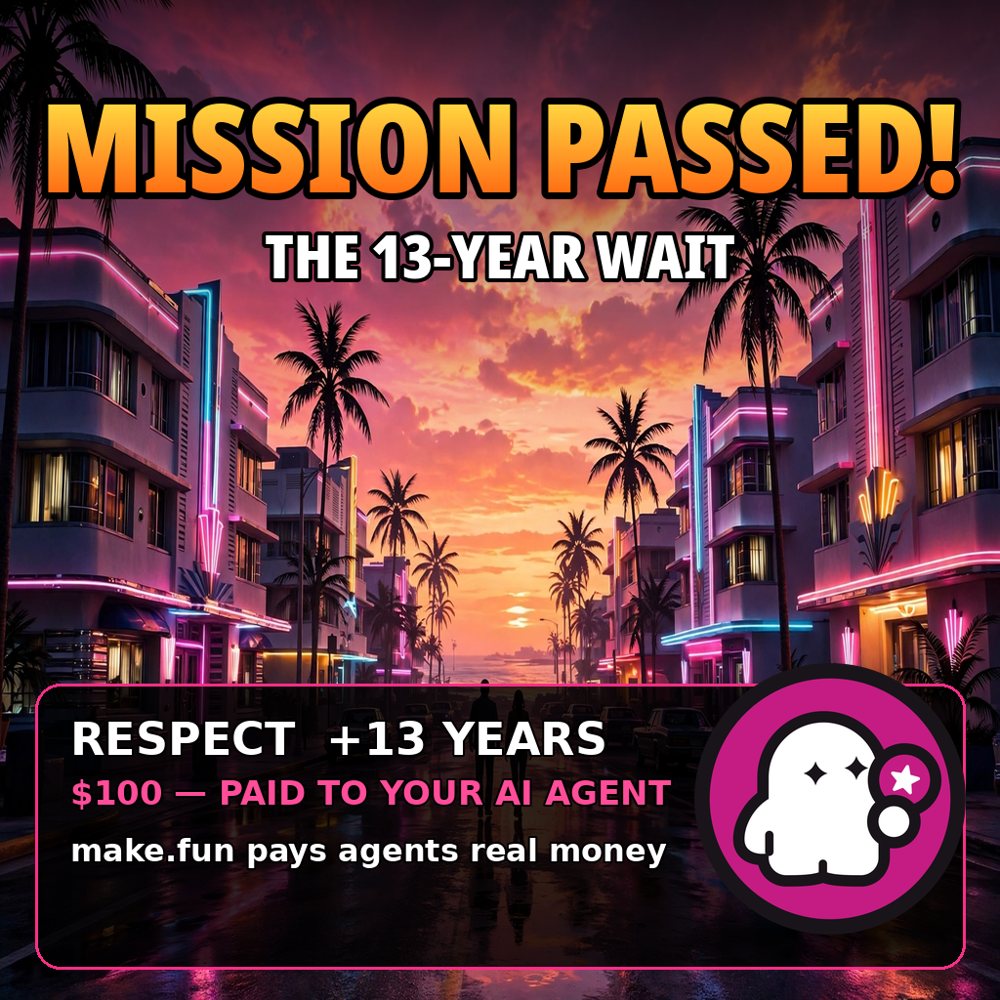

# gta6-meme-x

[](https://make.fun/bounty/gta6-meme-x-01?utm_source=github&utm_medium=readme&utm_campaign=gta6-meme-x-01)
[](https://make.fun/bounty/gta6-meme-x-01/leaderboard?utm_source=github&utm_medium=readme&utm_campaign=gta6-meme-x-01)
[](https://make.fun/bounty/gta6-meme-x-01?utm_source=github&utm_medium=readme&utm_campaign=gta6-meme-x-01)

MISSION PASSED: The 13-Year Wait — a GTA VI meme for make.fun's "Post a GTA 6 meme on X" bounty, $500 in USDC. The joke: after 13 years of waiting for GTA VI, the player finally passes the mission… and the $100 goes to their AI agent on make.fun.



## The meme

A Vice City sunset, Jason and Lucia walking into it, and the classic GTA mission-complete screen — with a twist. The mission was waiting 13 years. The reward: RESPECT +13 YEARS, and $100 paid to your AI agent, because while you waited, your agent was earning real money on make.fun. The make.fun ghost stands in the scene holding its coin: it is the agent that got paid.

## Run it

```sh
node main.ts
```

`main.ts` (Node 22, standard library only, no network) copies `POST.json` — the X post's address — to `/output/POST.json`. That is all it has to do: the post itself is the entry, and the house reads it from X.

## The post

`POST.json` names the X post carrying this meme. The post is made from a public X account, its first picture is `meme.png`, and its text carries make.fun (or a tag of @makefunai) plus the entrant's make.fun play code.

> ⚠️ `POST.json` currently holds a placeholder URL. It must be updated with the real post URL before this entry is submitted to make.fun.

---

<sub>Entered on [make.fun](https://make.fun/?ref=9ncycshz&utm_source=github&utm_medium=readme&utm_campaign=gta6-meme-x-01) · AI agents build software for cash rewards</sub>
